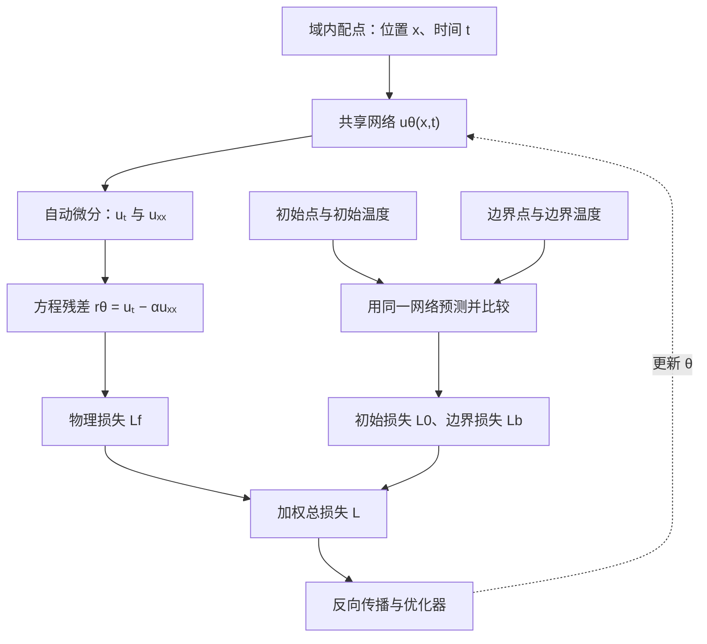
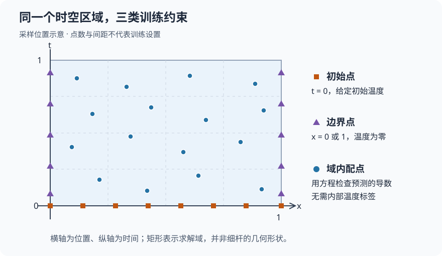
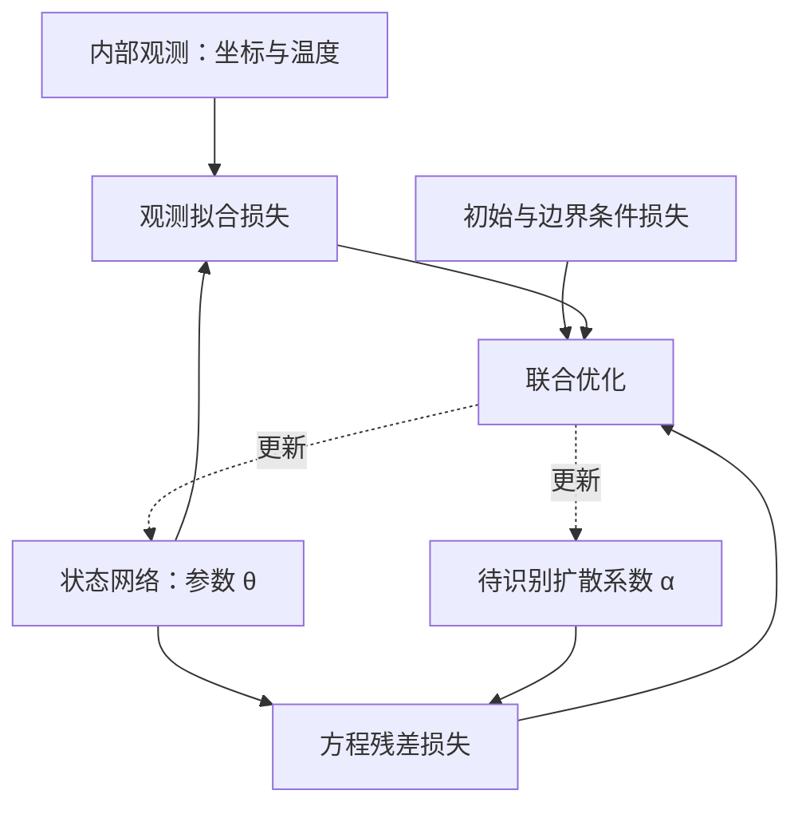

# 物理信息神经网络 PINN：从方程到训练

给定一根细杆的初始温度和两端温度，怎样预测它之后的温度分布？传统数值方法会离散热传导方程；物理信息神经网络（Physics-Informed Neural Network，PINN）则用神经网络表示温度场，再用方程和初边值条件约束这个函数。

本文以一维热方程为主线，说明 PINN 的输入输出、物理残差、自动微分与训练方法，最后给出 PyTorch 示例，并解释如何扩展到参数反演。阅读前需要了解神经网络、梯度下降和偏导数；不要求已有偏微分方程求解经验。

## 1. 神经网络到底在学习什么

普通监督学习通常提供输入与标签 $(x_i,y_i)$，要求模型预测接近标签。对于温度场，可以把空间位置 $x$、时间 $t$ 作为输入，把该位置和时刻的温度 $u(x,t)$ 作为标签。

但在很多物理问题中，完整温度场很难测量，而控制方程、初始条件和边界条件已知。PINN 将这些知识变成训练约束，让网络在缺少内部观测标签时仍有学习依据。[原始作者的项目说明](https://maziarraissi.github.io/PINNs/)展示了利用方程残差求解状态场和识别方程参数的基本思路。

这里的网络表示为：

$$
u_\theta(x,t)=\operatorname{NN}_\theta([x,t]).
$$

$\theta$ 是网络的权重和偏置，$u_\theta$ 是对真实温度场 $u$ 的近似。训练后的网络接收一个坐标对，输出一个温度值；它用同一组参数表示整个指定时空区域中的函数。

PINN 通常可以采用普通的多层感知机（Multilayer Perceptron，MLP）。物理知识主要体现在训练目标中，不要求网络必须有特殊的层结构。



图中的物理残差由同一个温度网络求导得到，没有额外训练一个独立的“物理网络”。初始点、边界点和域内配点分别提供不同的约束。

## 2. 用一维热方程建立完整问题

考虑已经无量纲化的细杆，空间和时间都取在 $[0,1]$，温度满足：

$$
\frac{\partial u}{\partial t}
=\alpha\frac{\partial^2u}{\partial x^2},
\qquad 0<x<1,\quad 0<t\leq1.
$$

$\alpha>0$ 是无量纲扩散系数。若使用有量纲变量，热扩散率的单位为长度平方除以时间；改变坐标尺度时，也需要相应变换方程系数。

指定初始条件和两端的定温边界条件：

$$
u(x,0)=\sin(\pi x),\qquad
u(0,t)=u(1,t)=0.
$$

初始时细杆中部温度高，两端温度为零，之后热量向两端扩散。在这些条件下，解析解为：

$$
u(x,t)=\exp(-\alpha\pi^2t)\sin(\pi x).
$$

可以直接验证：

$$
u_t=-\alpha\pi^2u,\qquad
u_{xx}=-\pi^2u,
\qquad u_t-\alpha u_{xx}=0.
$$

将 $t=0$ 或 $x=0,1$ 代入也能恢复初边值条件。这个解用于后续独立检验；训练时只使用方程和给定条件，不把域内解析解作为标签。

### 三类训练点各自负责什么



图中横轴是位置、纵轴是时间，矩形表示整个求解区域；它不是细杆的几何形状。点数和位置仅用于说明采样类型。

| 点集 | 位置 | 需要的信息 | 训练作用 |
| --- | --- | --- | --- |
| 初始点 | $t=0$ | 已知初始温度 $\sin(\pi x)$ | 确定起始状态 |
| 边界点 | $x=0$ 或 $x=1$ | 已知边界温度 $0$ | 限定两端状态 |
| 域内配点 | $0<x<1,\ 0<t<1$ | 控制方程与系数 $\alpha$ | 检查局部变化是否满足方程 |

**配点不需要真实温度标签。** 在某个配点，网络先输出温度，再计算该函数在此处的偏导数，最后检查方程左右两边是否相等。配点的“监督信号”来自方程本身。

单独约束方程还不够。例如 $u_\theta\equiv0$ 满足热方程和零边界，却不满足这里的初始温度。初始条件用于从满足方程的函数中确定目标解。

## 3. 把方程和条件写成损失

### 物理残差

将网络代入热方程，定义：

$$
r_\theta(x,t)
=\frac{\partial u_\theta}{\partial t}
-\alpha\frac{\partial^2u_\theta}{\partial x^2}.
$$

$r_\theta$ 衡量网络预测对方程的违反程度。设有 $N_f$ 个域内配点 $(x_i^f,t_i^f)$，物理损失为残差的均方值：

$$
\mathcal L_f=\frac1{N_f}\sum_{i=1}^{N_f}
\left|r_\theta(x_i^f,t_i^f)\right|^2.
$$

### 初始与边界损失

对于 $N_0$ 个初始点 $x_i^0$：

$$
\mathcal L_0=\frac1{N_0}\sum_{i=1}^{N_0}
\left|u_\theta(x_i^0,0)-\sin(\pi x_i^0)\right|^2.
$$

对于左右边界各 $N_b$ 个时间采样 $t_i^b$：

$$
\mathcal L_b=\frac1{2N_b}\sum_{i=1}^{N_b}
\left(\left|u_\theta(0,t_i^b)\right|^2
+\left|u_\theta(1,t_i^b)\right|^2\right).
$$

总损失将三部分组合起来：

$$
\mathcal L(\theta)=
\lambda_f\mathcal L_f+
\lambda_0\mathcal L_0+
\lambda_b\mathcal L_b.
$$

$\lambda_f,\lambda_0,\lambda_b$ 是正权重，控制各项在优化中的影响。下面的教学代码设为 $1,10,10$，用于强调初边值条件；这只是演示设置，需要结合独立验证调整。

如果还有 $N_d$ 个实测值 $y_i$，可增加观测损失：

$$
\mathcal L_d=\frac1{N_d}\sum_{i=1}^{N_d}
\left|u_\theta(x_i^d,t_i^d)-y_i\right|^2,
$$

并在总损失中加入 $\lambda_d\mathcal L_d$。实测数据、初边值条件和方程约束可以同时参与训练。

## 4. 自动微分为什么能计算物理残差

网络由线性变换与激活函数复合而成，自动微分（Automatic Differentiation，AD）沿计算图应用链式法则，计算输出对输入坐标的导数。对热方程，需要先求 $u_x$ 和 $u_t$，再对 $u_x$ 求一次空间导数得到 $u_{xx}$。

这与训练时求 $\partial\mathcal L/\partial\theta$ 是两种求导目标：

| 求导对象 | 目的 |
| --- | --- |
| 输出对坐标的导数 $u_x,u_t,u_{xx}$ | 构造物理残差 |
| 损失对参数的导数 $\partial\mathcal L/\partial\theta$ | 更新网络权重与偏置 |

构造残差时必须保留可求导的计算图，才能继续把残差损失传播回网络参数。PyTorch 的 [`torch.autograd.grad`](https://docs.pytorch.org/docs/2.14/generated/torch.autograd.grad.html) 提供 `create_graph=True` 来构造导数的计算图。

自动微分计算的是当前网络函数的导数。即使这个导数计算正确，网络函数本身仍可能偏离真实解，所以还需要训练与独立检验。

本例选用光滑的 `tanh` 激活函数。对于含二阶导数的强形式残差，直接使用分段线性的 ReLU 会使其二阶导数几乎处处为零，难以表达这里需要的平滑曲率。

## 5. PyTorch 最小训练示例

下面的代码实现上述正问题：$\alpha=0.1$ 已知，网络学习 $u_\theta$。使用 CPU、一个包含三个隐藏层的 MLP，以及 Adam 优化器；每轮重新采样域内点，初始点和边界点固定。

运行前需要已有可导入的 PyTorch 环境。将代码保存为 `pinn-heat.py`，使用 `python pinn-heat.py` 运行即可；除 PyTorch 外只使用 Python 标准库。自动微分接口已对照官方文档核对，当前编写环境没有安装 PyTorch，因此本示例尚未实跑，未提供训练耗时或精度实测值。

```python
import math
import torch
from torch import nn

torch.manual_seed(42)
alpha = 0.1

model = nn.Sequential(
    nn.Linear(2, 32), nn.Tanh(),
    nn.Linear(32, 32), nn.Tanh(),
    nn.Linear(32, 32), nn.Tanh(),
    nn.Linear(32, 1),
)
optimizer = torch.optim.Adam(model.parameters(), lr=1e-3)


def grad(y, z):
    return torch.autograd.grad(
        y, z, grad_outputs=torch.ones_like(y), create_graph=True
    )[0]


def residual(z):
    # z 的列顺序始终是 [x, t]，形状为 [N, 2]。
    u = model(z)
    du = grad(u, z)
    u_x = du[:, 0:1]
    u_t = du[:, 1:2]
    u_xx = grad(u_x, z)[:, 0:1]
    return u_t - alpha * u_xx


# 初始条件：t=0。
x0 = torch.linspace(0, 1, 64).reshape(-1, 1)
z0 = torch.cat([x0, torch.zeros_like(x0)], dim=1)
target0 = torch.sin(math.pi * x0)

# 边界条件：x=0 和 x=1，两个边界各取 64 个点。
tb = torch.linspace(0, 1, 64).reshape(-1, 1)
left = torch.cat([torch.zeros_like(tb), tb], dim=1)
right = torch.cat([torch.ones_like(tb), tb], dim=1)
zb = torch.cat([left, right], dim=0)

for step in range(1, 3001):
    optimizer.zero_grad(set_to_none=True)
    zf = torch.rand(512, 2, requires_grad=True)
    loss_f = residual(zf).square().mean()
    loss_0 = (model(z0) - target0).square().mean()
    loss_b = model(zb).square().mean()
    loss = loss_f + 10.0 * loss_0 + 10.0 * loss_b
    loss.backward()
    optimizer.step()

    if step % 500 == 0:
        print(
            f"step={step} total={loss.item():.3e} "
            f"pde={loss_f.item():.3e} "
            f"ic={loss_0.item():.3e} bc={loss_b.item():.3e}"
        )

# 用未参与训练的时空网格检查整个区域。
model.eval()
x = torch.linspace(0, 1, 101)
t = torch.linspace(0, 1, 101)
xx, tt = torch.meshgrid(x, t, indexing="ij")
z_test = torch.stack([xx.flatten(), tt.flatten()], dim=1)
with torch.no_grad():
    pred = model(z_test)
    exact = (
        torch.exp(-alpha * math.pi**2 * z_test[:, 1:2])
        * torch.sin(math.pi * z_test[:, 0:1])
    )
    relative_l2 = torch.linalg.vector_norm(pred - exact) / (
        torch.linalg.vector_norm(exact)
    )
    print(f"relative L2 error={relative_l2.item():.3e}")

    # 使用更密的初始点与边界点，报告最大绝对误差。
    q = torch.linspace(0, 1, 201).reshape(-1, 1)
    ic = torch.cat([q, torch.zeros_like(q)], dim=1)
    bc = torch.cat([
        torch.cat([torch.zeros_like(q), q], dim=1),
        torch.cat([torch.ones_like(q), q], dim=1),
    ], dim=0)
    ic_error = (model(ic) - torch.sin(math.pi * q)).abs().max()
    bc_error = model(bc).abs().max()
    print(f"max IC error={ic_error.item():.3e}")
    print(f"max BC error={bc_error.item():.3e}")

# 计算残差需要坐标梯度，必须放在 no_grad 上下文之外。
z_res = z_test.detach().clone().requires_grad_(True)
residual_rms = residual(z_res).detach().square().mean().sqrt()
print(f"test residual RMS={residual_rms.item():.3e}")
```

这里 `grad_outputs=torch.ones_like(y)` 实际计算输出之和对输入的梯度。由于本例 MLP 逐行独立处理样本，每个输出只依赖同一行坐标，结果可以解释为每个点的偏导。若加入跨样本耦合操作，就需要重新检查这一求导方式。

`zf` 每轮重新创建，既启用坐标梯度，也避免把上一轮计算图带入下一轮。`model.eval()` 与关闭自动求导是不同操作：评估温度时可以使用 `torch.no_grad()`，评估物理残差时仍要保留坐标求导。

### 怎样判断学到了目标解

程序每隔 500 轮输出物理、初始和边界损失，并在最后输出四类独立检验指标。相对 $L^2$ 误差定义为：

$$
\varepsilon_{\mathrm{rel}}=
\frac{\sqrt{\sum_{j=1}^{N_{\mathrm{test}}}
|u_\theta(x_j,t_j)-u(x_j,t_j)|^2}}
{\sqrt{\sum_{j=1}^{N_{\mathrm{test}}}|u(x_j,t_j)|^2}}.
$$

$N_{\mathrm{test}}$ 是独立测试网格的点数，本例的参考解非零，分母有定义。还应检查初边值最大误差与测试残差的均方根（Root Mean Square，RMS），并查看不同时间切片上的预测是否呈现正弦形状、幅值随时间衰减。

训练损失下降是优化进展的信号，验收需要结合这些独立指标。3000 轮只是教学预算，不保证达到特定精度；需要先确定任务要求，再据此决定是否增加训练、调整权重或改变采样。

## 6. 从求解温度场到反演扩散系数

正问题已知 $\alpha$，求解温度场。如果 $\alpha$ 未知，而有若干内部温度观测，就可以把它也作为待优化变量：

$$
(\theta^*,\eta^*)=
\operatorname*{arg\,min}_{\theta,\eta}
\left(\lambda_f\mathcal L_f(\theta,\alpha)
+\lambda_0\mathcal L_0+
\lambda_b\mathcal L_b+
\lambda_d\mathcal L_d\right),
\qquad \alpha=\operatorname{softplus}(\eta)>0.
$$

$\eta$ 是无约束标量，$\operatorname{softplus}(\eta)=\log(1+\exp\eta)$ 用于保证扩散系数为正。实现时要将 $\eta$ 加入优化器参数列表，并让残差中的 $\alpha$ 保持在计算图内。



对于本文构造的解析解，在 $0<x<1$、$t>0$ 且温度非零时，有：

$$
\frac{u(x,t)}{\sin(\pi x)}=\exp(-\alpha\pi^2t).
$$

因此内部温度随时间的衰减携带了 $\alpha$ 的信息。相比之下，只在零温边界采集数据，观测始终为零；只观测 $t=0$，数据又与 $\alpha$ 无关。这两种采样都无法单独识别此例的扩散系数。

反演之前应先判断观测对未知参数是否敏感，以及是否存在多组参数产生近似相同观测。物理约束能缩小候选范围，参数可辨识性仍取决于方程、观测位置、时间覆盖与噪声水平。

## 7. 为什么损失下降了，结果仍可能不好

基于残差的训练将求解问题转化为非凸优化。Krishnapriyan 等人的[失败模式研究](https://arxiv.org/html/2109.01050v2)在对流、反应与反应扩散算例中展示了优化困难，并讨论了课程训练和时间分段等改进方向。具体方法应根据当前问题的误差表现选择。

| 现象 | 优先检查 | 可尝试的调整 |
| --- | --- | --- |
| 物理损失很小，温度接近全零 | 初始损失是否仍然很大 | 增强初始约束，检查各项梯度与采样 |
| 初边值拟合较好，内部误差大 | 独立配点上的残差及空间分布 | 增加覆盖，在高残差区域补点 |
| 某项损失长期主导总损失 | 量纲、归一化与权重 | 先无量纲化，再调整损失平衡 |
| 导数为零或梯度断开 | 激活函数、坐标梯度和计算图 | 使用适合的光滑激活，检查 `detach` 与 `no_grad` |
| 早期较好，长时间段偏差大 | 各时间切片的误差 | 考虑分时间段训练，并检查段间衔接 |

“无量纲化”和“把输入缩放到相近范围”需要一起考虑。若令 $\hat x=x/L$、$\hat t=t/T$，则方程变为：

$$
\frac{\partial u}{\partial\hat t}
=\frac{\alpha T}{L^2}
\frac{\partial^2u}{\partial\hat x^2}.
$$

此处 $L,T>0$ 是选定的长度与时间尺度。缩放输入后，应保留对应的链式法则或使用变换后的系数，避免训练了另一个方程。

### 软约束和硬约束

前面的初边值条件通过损失惩罚实施，属于软约束。也可以直接构造满足条件的试探解，例如：

$$
u_\theta(x,t)=\sin(\pi x)+t\,x(1-x)N_\theta(x,t).
$$

其中 $N_\theta$ 是可训练网络。代入 $t=0$ 时修正项消失；代入 $x=0$ 或 $x=1$ 时两项都为零，因此该表达式对任意参数都满足本文的初边值条件。此时可将优化重点放在方程残差上。

硬约束的构造依赖边界形式、几何与条件之间的相容性，也会改变优化问题。使用时仍需验证物理残差及独立误差，不能仅凭条件被精确满足就认定求解准确。

## 8. 把 PINN 放在合适的位置

PINN 提供了把观测、控制方程与可微函数表示放到同一优化问题中的方式。本文训练的是一个固定方程、固定初边值条件下的解；更换条件或系数后，通常需要重新训练，或额外设计参数化输入与训练集合。

对于已有成熟网格求解器的正问题，应在相同精度、硬件和问题规模下比较训练成本与传统数值计算成本。对于稀疏观测下的参数反演，则需要重点检查物理模型是否合适、参数能否被观测区分，以及噪声对结果的影响。

初学时可以先完成本文热方程的闭环：推导残差、实现坐标求导、分项记录损失，再用解析解检查整个时空区域。掌握这个过程后，再增加未知系数、复杂边界或多物理场耦合，每次变化都保留独立验证依据。

## 参考资料

- [Raissi 等：Physics-Informed Neural Networks 项目与方法说明](https://maziarraissi.github.io/PINNs/)：连续时间残差构造、初边值约束与参数识别示例。
- [PyTorch：torch.autograd.grad](https://docs.pytorch.org/docs/2.14/generated/torch.autograd.grad.html)：向量—雅可比积、`grad_outputs` 与 `create_graph` 的接口定义。
- [Krishnapriyan 等：Characterizing possible failure modes in physics-informed neural networks](https://arxiv.org/html/2109.01050v2)：软物理约束的优化困难及改进算例。

本文热方程推导与采样示意图为教学构造；图示不表示训练结果，代码的验证范围见实现小节。
